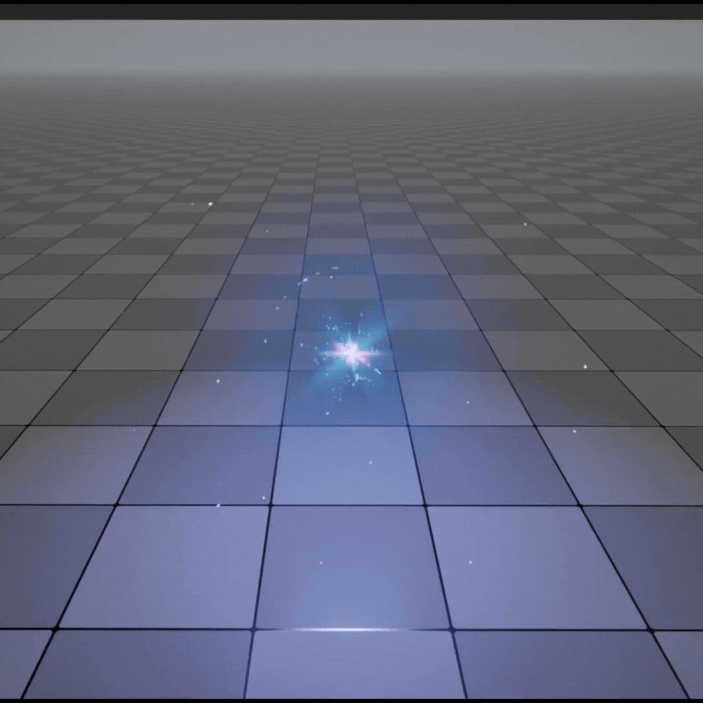

<!-- BANNER HERE -->
<h1 align="center">Hi There!</h1>

<p align="center">
  <a href="https://altnon.itch.io/"></a>
  <a href="https://github.com/altnon"></a>
  <a href="mailto:ellenoirbe@gmail.com"></a>
</p>

<p align="center">
  <i>I'm Ellenoir Bilar a gameplay programmer that also dables in technical art. I specialize in creating the core systems for my games but when that is out of the way I spend my time creating shaders and tools to help the design process.</i>
</p>

---
```csharp

public enum DevClass { GameplayProgrammer, TechnicalArtist, SystemsProgrammer }
public enum GameEngine { Unity, Unreal }
public enum GameProjects {BiscuitGremlins, SignalNo5, FromAllThatIWas, TheTinyTimeKeeper}

public class Profile : MonoBehaviour
{
    public GameProject ActiveProject  = GameProjects.TheTinyTimeKeeper;
    [SerializeField] private DevClass primaryClass = DevClass.GameplayProgrammer;
    [SerializeField] private GameEngine currentEngine = GameEngine.Unity;
}
```
---
<!-- PROGRAMMING BREAKDOWN HERE -->
---

## Signal No. 5
<table width="100%">
  <tr>
    <td width="50%" valign="middle" align="center">
      
      <p align="center" style="margin-top: 10px;">
        <a href="https://altnon.itch.io/signal-no-5"></a>
      </p>
    </td>

  <td width="50%" valign="middle" style="padding-left: 15px;">  
    <p><b>Contribution 1</b><br>
      <sub style="color: #58a6ff;">TimeStamp</sub></p>
    <p><b>Contribution 2</b><br>
      <sub style="color: #58a6ff;">TimeStamp</sub></p>
   <p><b>Contribution 3</b><br>
      <sub style="color: #58a6ff;">TimeStamp</sub></p>
  </td>
  </tr>
</table>

## From All That I Was
<table width="100%">
  <tr>
    <td width="50%" valign="middle" align="center">
      
      <p align="center" style="margin-top: 10px;">
        <a href="https://altnon.itch.io/signal-no-5"></a>
      </p>
    </td>

  <td width="50%" valign="middle" style="padding-left: 15px;">  
    <p><b>Contribution 1</b><br>
      <sub style="color: #58a6ff;">TimeStamp</sub></p>
    <p><b>Contribution 2</b><br>
      <sub style="color: #58a6ff;">TimeStamp</sub></p>
   <p><b>Contribution 3</b><br>
      <sub style="color: #58a6ff;">TimeStamp</sub></p>
  </td>
  </tr>
</table>

## Biscuit Gremlins
<table width="100%">
  <tr>
    <td width="50%" valign="middle" align="center">
      
      <p align="center" style="margin-top: 10px;">
        <a href="https://altnon.itch.io/signal-no-5"></a>
      </p>
    </td>

  <td width="50%" valign="middle" style="padding-left: 15px;">  
    <p><b>Contribution 1</b><br>
      <sub style="color: #58a6ff;">TimeStamp</sub></p>
    <p><b>Contribution 2</b><br>
      <sub style="color: #58a6ff;">TimeStamp</sub></p>
   <p><b>Contribution 3</b><br>
      <sub style="color: #58a6ff;">TimeStamp</sub></p>
  </td>
  </tr>
</table>

<h2 align="center">Other Projects</h2>

<table align="center">
  <tr>
    <td align="center" width="33%">
      <h3>Sparks VFX</h3>
      <a href=""></a>
    </td>
    <td align="center" width="33%">
      <h3>Explosion</h3>
      <a href=""></a>
    </td>
    <td align="center" width="33%">
      <h3>Vortex VFX</h3>
      <a href="Assets/VortexVFX.gif"></a>
    </td>
  </tr>
</table>

---